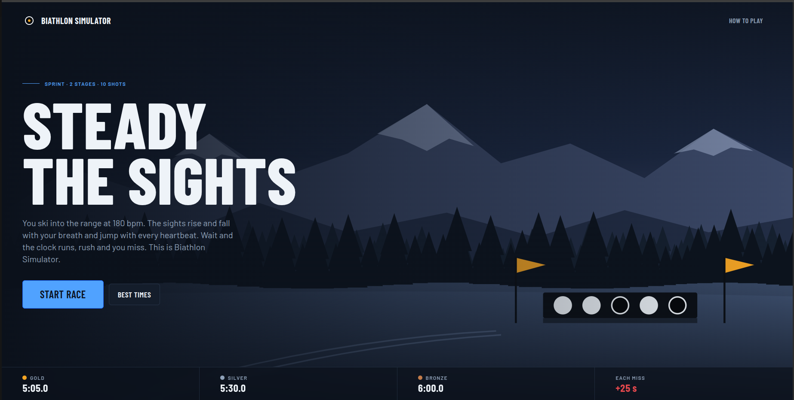

# Biathlon Simulator 
A small browser game, about the hardest part of Biathlon: the shooting range.

Try it on: `https://alessioferrari8.github.io/BiathlonSimulator/`



Pick an athlete and a race format. Before every stage choose how hard you ski: a faster lap saves seconds, but you arrive at the range with an high BPM, a racing heart and shaking sights. At the range your sights rise and fall with your breath, and jump with every heartbeat. Waiting, calms you down while the clock keeps running. Every miss costs you time.


## How to use it
Visit this [page](https://alessioferrari8.github.io/BiathlonSimulator/), and just start playing. 
For now it just works on PC. Phone and tablet support is next.

## Controls

| | Mouse / keyboard |
|---|---|
| Aim | move the mouse, or arrow keys |
| Fire | left click, `Enter` or `F` |
| Hold breath | hold `Space` or the right button |

Holding your breath freezes the sights, but after 2.5 s they shake more.

## Race Formats

| Format | Stages | Miss |
|---|---|---|
| Sprint | prone, standing | 25 s penalty loop |
| Individual | prone, standing, prone, standing | +60 s |
| Mass start | prone, prone, standing, standing | 25 s penalty loop |

Each format has its own medal times and its own top 5, kept in your browser.

## Athletes
8 World Cup biathletes, men and women, rated 1-10 on ski, prone and standing. Every ski point above 5 takes 1.5% off your lap time, every shooting point above 5 takes 6% off the sway in that position.

## Local 

```bash
npm i
npm start # http://localhost:4200
npm test # tests
npm run build # builds the static site in dist/frontend/browser
```

If you have Angular installed:

```bash
npm i -g @angular/cli
ng serve # http://localhost:4200
ng tests # tests
ng build # builds the static site dist/frontend/browser
```

The build is a static site with hash routning, and a relative base path, so it can be served from any folder (Github Pages included). Best times are kept in the browser only.

## Tech Stack
- Angular 22
- Tailwind 4
- one canvas

The game rules live in `src/app/game` as plain TS: `shooter.ts` is the sway model, `race.ts` the race state machine, `renderer.ts` draws a frame.